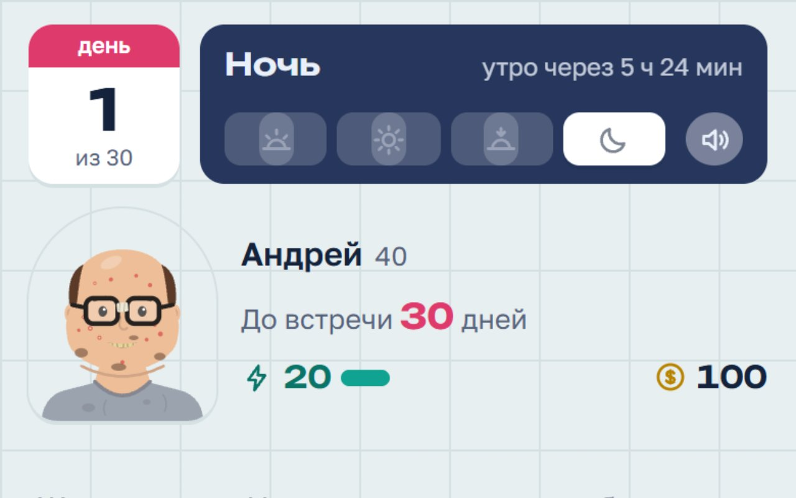

# 30 Days (Glowup)

[Русская версия](README.ru.md)

A mobile game in the spirit of BitLife: 30 real days, a hero with a set of problems, and one crush with hidden tastes. It is a web app in TypeScript and Preact, meant to ship to the stores through Capacitor. The in-game text is in Russian.



**[Open the demo](https://antropos17.github.io/glowup/)**

## Run

```bash
npm install
npm run dev            # the game and the asset showcase in the browser
npm test               # engine tests
npm run check:content  # scenario validation
npm run build          # a single dist/index.html
```

## Layout

| Folder | Contents |
|---|---|
| `content/` | The scenario as JSON; currently day 1 of the demo |
| `docs/CONTENT_FORMAT.en.md` | How to write cards, conditions and effects |
| `src/engine/` | Headless core: time, energy, deck, memory, chance, verdict |
| `src/art/` | The layered hero (portrait and full body) and icons, all in code |
| `src/ui/` | Game screens and the asset showcase |
| `server/` | A draft of a thin Supabase server, not deployed |
| `tests/` | Engine tests |

## Not done yet

- Demo days 2–7: after day 1 the game shows "to be continued".
- Capacitor is not wired in.
- The server is not deployed; the game uses the device clock.
- No purchase verification for Google Play or the App Store.
- No photo upload in chat.

## Stack

TypeScript, Preact, Vite (single-file build), Vitest.
